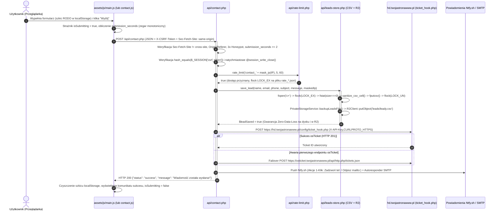
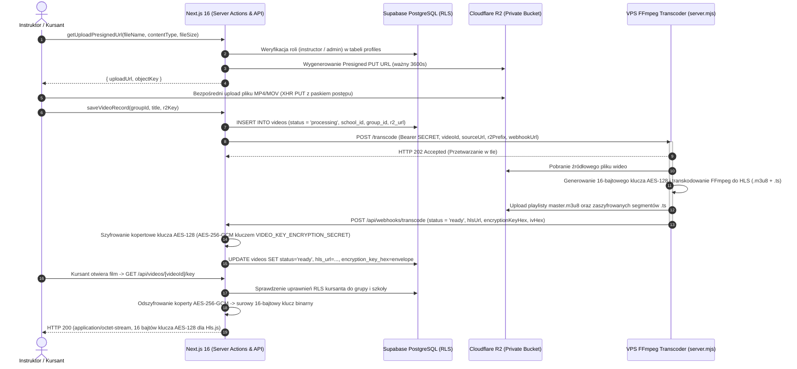
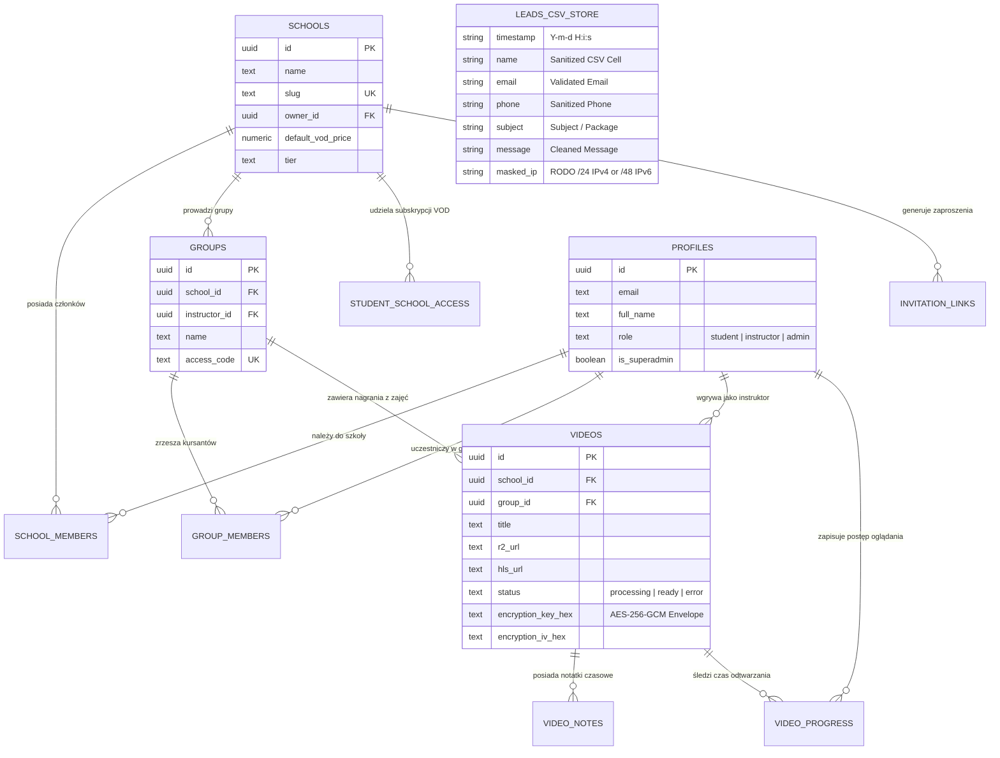
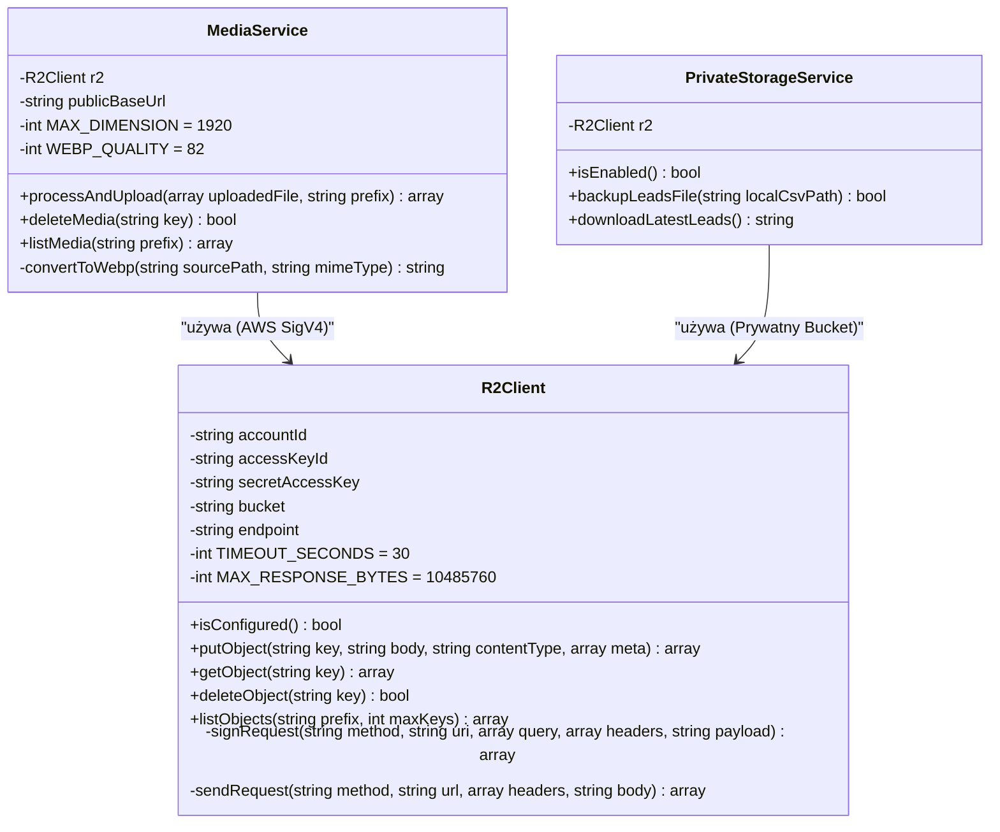

# MAPA ARCHITEKTURY SYSTEMU I DOKUMENTACJA TECHNICZNA (`ARCHITECTURE_MAP.md`)

> **Zakres dokumentacji:** Architektura referencyjna szablonu bazowego **`_site-template`** oraz pełnego ekosystemu **10 repozytoriów TwojaStronaWWW i kpoczatek (`kpoczatek-dev`)**.

---

## 1. Opis Architektury Systemu i Stosu Technologicznego

Ekosystem **TwojaStronaWWW & kpoczatek** został zaprojektowany w oparciu o paradygmat **Platform-First, Zero-Bloat & Zero-Trust (ISO/IEC 27001)** i składa się z czterech ściśle współpracujących warstw architektonicznych:

### 1.1. Warstwa 1: Szablon Referencyjny i Witryny Klienckie (`_site-template`, `twojastronawww`, `fuegolingua`, `katosalsahub`, `raricart`, `Moje-CV`)
- **Frontend (Zero-Framework):** Semantyczny HTML5 z optymalizacją kolejności `<head>` wg **Capo.js (`[REF-02]`)** oraz deklaratywnym `<script type="speculationrules">` (prerendering podstron w `0 ms`). Warstwa prezentacji oparta na nowoczesnym **Vanilla CSS** (zmienne systemowe `--color-*`, Grid, Flexbox, `scrollbar-gutter: stable`, `@view-transition`, `text-wrap: balance/pretty` wg **`[REF-03]`**). Warstwa interakcji napisana w modułowym **Vanilla ES6+** (`assets/js/main.js`, `assets/js/ai-widget.js`) ze wsparciem trybu offline PWA (`sw.js`) oraz standardu **GEO `/llms.txt` (`[REF-07]`)**.
- **Backend (Lightweight PHP 8.3):** Bezstanowe lub lekkosesyjne endpointy PHP (`api/contact.php`, `api/csrf.php`, `api/admin.php`, `katosalsahub.pl/assets/php/wiki.php`) z ochroną `Sec-Fetch-Site` (**`[REF-05]`**), walidacją `Origin`/`Referer`, porównaniem tokenów CSRF w stałym czasie (`hash_equals`), maskowaniem adresów IP zgodnym z RODO (`mask_ip`), plikowym rate-limiterem (`api/rate-limit.php`) i transakcyjnym zapisem danych z wyłączną blokadą jądra systemu (`flock($fp, LOCK_EX)`).
- **Chmura Obiektowa Cloudflare R2:** Natywny, bezbiblioteczny klient `api/R2Client.php` implementujący protokół kryptograficzny **AWS Signature Version 4 (HMAC-SHA256)** przez cURL (`CURLPROTO_HTTPS`), wykorzystywany przez `MediaService.php` (konwersja obrazów GD do formatu WebP) oraz `PrivateStorageService.php` (kopie zapasowe baz leadów CSV).
- **Weryfikacja Jakości (Zero-Dependency Testing):** Wbudowany runner `node:test` i `node:assert/strict` z autorską symulacją DOM (`tests/helpers/mock-dom.js` z globalnym strażnikiem `NETWORK_FORBIDDEN`), testy dymne UI w **Playwright Chromium** (`tests/smoke/ui-smoke.js`) oraz audyt **Lighthouse CI** (`.lighthouserc.json`).

### 1.2. Warstwa 2: Centralna Infrastruktura VPS i Bramka AI RAG (`VPS` / `devops-stack`)
- **Bramka Brzegowa i Sieć Zero-Trust:** Kontener **Caddy 2 (`tls-proxy`)** terminujący ruch HTTPS na subdomenach `*.twojastronawww.pl` z automatycznym HSTS i nagłówkami bezpieczeństwa. Dostęp administracyjny (SSH, Grafana, Prometheus, Portainer, Uptime-Kuma, Dozzle, Filebrowser) odcięty od publicznego internetu i dostępny wyłącznie wewnątrz szyfrowanej sieci **Tailscale WireGuard Mesh VPN (`100.x.y.z`)**.
- **Centralny VPS AI Router (`services/ai-router`):** Wielodostępny mikroserwis PHP 8.3 (`chat-router.php`, `router-endpoints.php`) obsługujący:
  - **Hybrydowy silnik RAG (`SQLite FTS5 BM25` + `knowledge_index.json`):** Wyszukiwanie pełnotekstowe z dynamicznym doborem fragmentów wiedzy per `site_id` (`<site_id>-knowledge.txt`) oraz pamięcią podręczną odpowiedzi (`< 5 ms`).
  - **15-modelową kaskadę LLM u 6 dostawców:** Google Gemini (`2.5-flash`, `3-flash`, `2.5-pro`, `3.1-pro`, `2.5-flash-lite`, `3.1-flash-lite`, `gemma-4-31b-it`), Groq LPU (`llama-3.3-70b`, `qwen3-32b`), Cerebras WSE (`llama3.1-8b`), Cloudflare Workers AI (`@cf/meta/llama-3.3-70b-instruct-fp8-fast`), OpenRouter (`:free`) oraz Anthropic Claude Haiku 4.5 (audytor bezpieczeństwa PR).
  - **Ekstrakcję Leadów 1-Klik:** Automatyczne wykrywanie numeru telefonu lub adresu e-mail w wiadomości czatu i natychmiastowa wysyłka powiadomienia Push **Ntfy.sh** (z przyciskami `tel:` i `mailto:`) oraz zgłoszenia do **osTicket**.

### 1.3. Warstwa 3: Centralny System Helpdesk (`hd-osticket-helpdesk`)
- Dedykowana bramka webhookowa `config/ticket_hook.php` osadzona przed silnikiem **osTicket (`hd.twojastronawww.pl`)**, przyjmująca zgłoszenia z formularzy kontaktowych wszystkich stron oraz z czatu AI, weryfikująca klucz `X-API-Key` w stałym czasie (`hash_equals`), mapująca `site_id` na dedykowany `topicId` i uruchamiająca kaskadę awaryjną (`Ticket::create()` $\rightarrow$ lokalny plik `failed_leads.log` z `LOCK_EX` $\rightarrow$ e-mail zapasowy).

### 1.4. Warstwa 4: Aplikacje Specjalistyczne (`radar-p1` oraz `sejf-vod`)
- **`radar-p1`:** Zabezpieczony pulpit telemetryczny incydentów P1 (NFZ / e-Zdrowie / SIMP / KSeF) na **Cloudflare Pages + Edge Worker (`public/_worker.js`)** z szyfrowanym proxy `/radar-data` i natywnym silnikiem wykresów SVG (`public/js/charts.js`).
- **`sejf-vod` (`vod-dance-mvp`):** Platforma VOD dla szkół tańca oparta na **Next.js 16 (App Router, React 19, TypeScript)**, bazie **Supabase (PostgreSQL + Row-Level Security)**, płatnościach **Stripe / Tpay**, bezpośrednim przesyłaniu wideo do **Cloudflare R2** oraz mikroserwisie transkodującym **FFmpeg HLS z szyfrowaniem kopertowym AES-128-CBC (`vps-transcoder/server.mjs`)**.

---

## 2. Diagramy Architektury Systemu (Mermaid.js)

### 2.1. Diagram Architektury Komponentów i Modułów Ekosystemu (`graph TD`)

```mermaid
graph TD
    subgraph Client_Browser["Przeglądarka Użytkownika (Vanilla ES6 + PWA)"]
        UI_HTML["Semantyczny HTML5 + CSS Grid/Tokens (index.html / index.php)"]
        UI_MAIN["Moduł UI i Formularzy (assets/js/main.js, contact.js)"]
        UI_AI["Widget Asystenta AI (assets/js/ai-widget.js)"]
        UI_SW["Service Worker PWA (sw.js)"]
        UI_VOD["Klient Sejf-VOD (Next.js 16 + HlsPlayer AES-128)"]
        UI_RADAR["Klient Radar-P1 (SPA + Custom SVG Charts)"]
    end

    subgraph Cloudflare_Edge["Warstwa Brzegowa Cloudflare (CDN / WAF / Workers / R2)"]
        CF_WAF["Cloudflare CDN & WAF (HTTP/3, Brotli, SSL Strict)"]
        CF_WORKER["Cloudflare Pages Worker (radar-p1/public/_worker.js)"]
        CF_R2_PUB["Cloudflare R2 Public Media (media.raricart.pl / fuegolingua)"]
        CF_R2_PRIV["Cloudflare R2 Private Vault (leads backup & Sejf-VOD HLS)"]
    end

    subgraph Shared_Hosting["Serwery Aplikacyjne WWW (Apache / PHP 8.3)"]
        PHP_CONTACT["Endpoint Kontaktowy (api/contact.php + csrf.php)"]
        PHP_STORE["Magazyn Leadów CSV (api/leads-store.php + LOCK_EX)"]
        PHP_LIMIT["Strażnik Ruchu IP (api/rate-limit.php)"]
        PHP_R2["Klient AWS SigV4 (api/R2Client.php + MediaService.php)"]
        PHP_WIKI["Silnik Salsopedii i Radia (katosalsahub/wiki.php + radio.php)"]
        PHP_ADMIN["Panele Administracyjne (api/admin.php, raricart/admin/*)"]
    end

    subgraph VPS_Core["Centralny Serwer VPS (Docker Compose + Tailscale VPN)"]
        CADDY["Bramka TLS Caddy 2 (ai.twojastronawww.pl)"]
        AI_ROUTER["VPS AI Router (chat-router.php + router-endpoints.php)"]
        SQLITE_RAG["Baza Wiedzy RAG (SQLite FTS5 BM25 + *-knowledge.txt)"]
        LLM_CASCADE["Kaskada 15 Modeli LLM (Gemini / Groq / Cerebras / CF / Claude)"]
        TRANSCODER["Transkoder Wideo FFmpeg (sejf-vod/vps-transcoder/server.mjs)"]
        MON_STACK["Monitoring (Prometheus + Grafana + Uptime-Kuma + Ntfy.sh)"]
        GH_RUNNERS["GitHub Self-Hosted Runners (runner-unified / tsw / web)"]
    end

    subgraph External_Services["Systemy Zewnętrzne i Bazy Danych"]
        OSTICKET["Centralny Helpdesk osTicket (hd.twojastronawww.pl / ticket_hook.php)"]
        SUPABASE["Supabase Cloud (PostgreSQL 19 Tabel + RLS + Auth)"]
        STRIPE["Bramki Płatności (Stripe Checkout & Webhooks)"]
    end

    UI_HTML --> UI_MAIN
    UI_HTML --> UI_AI
    UI_HTML --> UI_SW
    UI_MAIN -->|"POST JSON + X-CSRF-Token"| CF_WAF
    UI_AI -->|"POST /chat-router.php"| CF_WAF
    UI_RADAR -->|"GET /radar-data"| CF_WORKER

    CF_WAF --> PHP_CONTACT
    CF_WAF --> PHP_WIKI
    CF_WAF --> PHP_ADMIN
    CF_WAF --> CADDY

    PHP_CONTACT --> PHP_LIMIT
    PHP_CONTACT --> PHP_STORE
    PHP_STORE --> PHP_R2
    PHP_ADMIN --> PHP_R2
    PHP_R2 -->|"PUT / GET (AWS SigV4)"| CF_R2_PUB
    PHP_R2 -->|"PUT leads/leady.csv"| CF_R2_PRIV
    PHP_CONTACT -->|"POST /config/ticket_hook.php"| OSTICKET
    PHP_CONTACT -->|"POST Push 1-Klik"| MON_STACK

    CADDY --> AI_ROUTER
    AI_ROUTER --> SQLITE_RAG
    AI_ROUTER --> LLM_CASCADE
    AI_ROUTER -->|"Lead 1-Klik"| MON_STACK
    AI_ROUTER -->|"Webhook Lead AI"| OSTICKET

    UI_VOD -->|"Server Actions / Auth"| SUPABASE
    UI_VOD -->|"Presigned PUT / HLS Stream"| CF_R2_PRIV
    UI_VOD -->|"POST /transcode"| TRANSCODER
    TRANSCODER -->|"FFmpeg HLS AES-128"| CF_R2_PRIV
    UI_VOD -->|"Subskrypcje VOD"| STRIPE
```



---

### 2.2. Diagramy Sekwencji (`sequenceDiagram`) dla 3 Najważniejszych Procesów Biznesowych

#### Proces 1: Przesyłanie Leada Kontaktowego Zero-Data-Loss z Dual-Endpoint Failover (`_site-template`, `fuegolingua`, `katosalsahub`, `twojastronawww`, `raricart`)



#### Proces 2: Wieloturowy Asystent AI RAG z Ekstrakcją Leadów 1-Klik (`ai-widget.js` $\rightarrow$ `VPS/services/ai-router`)

```mermaid
sequenceDiagram
    autonumber
    actor User as Klient na Stronie
    participant Widget as assets/js/ai-widget.js
    participantCache as localStorage (Response Cache)
    participant Router as VPS chat-router.php
    participant FTS as SQLite FTS5 RAG (<site_id>-knowledge.txt)
    participant LLM as Kaskada 15 Modeli LLM
    participant Lead as Ntfy.sh Push & osTicket

    User->>Widget: Wpisuje pytanie lub zostawia telefon/e-mail w oknie czatu
    Widget->>Widget: Sprawdzenie hasContactPii(message) (regex telefonu i e-maila)
    alt Zapytanie ogólne (brak danych kontaktowych PII) i aktywny wpis w Cache
        Widget->>participantCache: getCachedReply(siteId, normalizedQuery, kbVersion)
        participantCache-->>Widget: Zwrócenie odpowiedzi z cache (< 1 ms)
    else Nowe zapytanie lub wiadomość zawiera numer telefonu / e-mail (hasContactPii = true)
        Widget->>Router: POST https://ai.twojastronawww.pl/chat-router.php (site_id, message, history)
        activate Router
        Router->>Router: Walidacja CORS (ALLOWED_ORIGINS), Rate-Limit IP + Penalty-Box
        Router->>FTS: Wyszukiwanie kontekstu BM25 (SQLite FTS5) i odczyt kbVersion (md5)
        FTS-->>Router: Dopasowane sekcje bazy wiedzy + Guardrails anty-halucynacyjne
        Router->>LLM: Wywołanie modelu z kaskady (Gemini 2.5/3 -> Gemma 4 -> Groq -> Cerebras -> CF)
        LLM-->>Router: Odpowiedź tekstowa + kbVersion
        opt Wykryto telefon lub e-mail w wiadomości użytkownika
            Router->>Lead: Natychmiastowy Push Ntfy.sh (📞 TELEFON / ✉️ E-MAIL na górze) + Ticket osTicket
        end
        Router-->>Widget: HTTP 200 {"reply": "...", "kbVersion": "...", "provider": "..."}
        deactivate Router
        Widget->>Widget: Walidacja kbVersion (unieważnienie cache przy zmianie bazy wiedzy)
        Widget->>Widget: Bezpieczne renderowanie formatMarkdown() (escapeHtml przed tagami)
    end
    Widget-->>User: Wyświetlenie sformatowanej odpowiedzi w oknie czatu
```

#### Proces 3: Bezpośredni Upload Wideo do R2, Transkodowanie HLS AES-128 i Kopertowe Dostarczanie Kluczy (`sejf-vod`)



---

### 2.3. Diagram Struktury Danych i Klas Serwisowych (`erDiagram` & `classDiagram`)

#### Diagram Relacji Danych (`erDiagram` — Platforma `sejf-vod` + Magazyny Plikowe `TwojaStronaWWW`)



#### Diagram Klas Serwisowych Backendu PHP (`classDiagram`)



---

## 3. Kompleksowa Tabela Wszystkich Endpointów API, Komend CLI, Widoków i Klas Serwisowych

### 3.1. Szablon Bazowy i Witryny Klienckie (`_site-template`, `twojastronawww`, `fuegolingua`, `katosalsahub`, `raricart`, `Moje-CV`)

| Projekt | Ścieżka / Zasób | Typ | Metoda / Wywołanie | Opis i Zależności |
|---|---|---|---|---|
| `_site-template` / `fuegolingua` | `api/contact.php` | Endpoint API | `POST` (JSON/Form) | Walidacja `Sec-Fetch-Site`, `Origin`, CSRF, 3x Honeypot, zegara `>= 2s`, zapis do CSV (`LOCK_EX`), kopia R2, webhook osTicket, Push Ntfy.sh i autoresponder SMTP. Zależności: `leads-store.php`, `rate-limit.php`. |
| `_site-template` / `fuegolingua` | `api/csrf.php` | Endpoint API | `GET` | Inicjalizuje bezpieczną sesję w `api/sessions/` (`0700`), generuje 32-bajtowy token `$_SESSION['csrf_token']` i ustawia znacznik czasu `form_loaded_at`. |
| `_site-template` / `fuegolingua` | `api/admin.php` | Widok / API | `GET`, `POST` | Panel administracyjny: logowanie hasłem/PIN-em (`ADMIN_SECRET`), podgląd leadów z CSV/R2, upload i usuwanie mediów WebP w Cloudflare R2. Zależności: `MediaService.php`, `PrivateStorageService.php`. |
| `_site-template` / `fuegolingua` | `api/lead_recovery.php` | Endpoint API | `GET`, `POST`, `OPTIONS` | Endpoint informacyjny potwierdzający RODO-zgodne przechowywanie szkicu formularza wyłącznie w `localStorage` przeglądarki. |
| `_site-template` / `fuegolingua` / `raricart` | `api/R2Client.php`, `MediaService.php`, `PrivateStorageService.php` | Klasy Serwisowe | PHP Class | Klient obiektowy S3/R2 z podpisem AWS SigV4 (`R2Client`), konwerter obrazów GD do WebP (`MediaService`) oraz serwis archiwizacji leadów (`PrivateStorageService`). |
| `_site-template` / wszystkie | `assets/js/ai-widget.js` | Moduł JS | ES6 / IIFE | Uniwersalny widżet czatu AI RAG (profile `site_id`, ochrona XSS w `formatMarkdown()`, inwalidacja cache po `kbVersion`, ekstrakcja PII `hasContactPii`, fallback offline). |
| `_site-template` / `Moje-CV` | `scripts/serve.js`, `scripts/generate-pdf.js` | Komendy CLI | `npm run serve`, `npm run build:pdf` | Lokalny serwer deweloperski HTTP z blokadą plików wrażliwych oraz generator plików PDF przez Headless Chromium (Playwright). |
| `twojastronawww` | `api/bootstrap.php`, `api/get-csrf-token.php`, `api/export-leads.php` | Endpointy API | `GET`, `POST` | Inicjalizacja sesji i `.env`, wydawanie tokenów CSRF oraz eksport bazy leadów do pliku CSV. |
| `katosalsahub` | `katosalsahub.pl/assets/php/wiki.php` | Endpoint API | `GET`, `POST` | Silnik CMS Salsopedii: `get_data`, `vote`, `vote_category`, `propose_edit`, `login`, `logout`, `approve_edit`, `reject_edit`, `save_all`, `get_history`, `restore_version`, `get_moderators`, `save_moderator`. |
| `katosalsahub` | `katosalsahub.pl/assets/php/radio.php` | Endpoint API | `GET` | Resolver adresu brzegowego strumienia audio Zeno.fm dla odtwarzacza Web Audio API (`assets/js/radio.js`). |
| `katosalsahub` | `scripts/sync_engine.js`, `sync-schedules.js`, `prerender-salsopedia.js` | Komendy CLI | `node scripts/...` | Potok ETL pobierający wydarzenia i grafiki ze stron szkół salsy, aktualizujący `events.json`/`schedule.json` i prerenderujący HTML Salsopedii pod SEO. |
| `raricart` | `index.php`, `pakiety.php`, `polityka-prywatnosci.php` + `parts/*.php` | Widoki SSR | `GET` | Komponentowe widoki PHP wstrzykujące treści z `assets/data/content.json`, `gallery.json` i `status.json` (`api/core.php`). |
| `raricart` | `admin/dashboard.php`, `upload.php`, `delete.php`, `save_content.php`, `save_gallery.php`, `save_status.php`, `download_leads.php`, `sync_leads.php` | Panel CMS / API | `GET`, `POST` | Zarządzanie galerią, tekstami, statusem dostępności i bazą leadów (`admin/leady.csv`) z automatycznym czyszczeniem cache LiteSpeed (`X-LiteSpeed-Purge: *`). |

---

### 3.2. Centralny VPS, Helpdesk osTicket, Radar-P1 oraz Sejf-VOD

| Projekt | Ścieżka / Zasób | Typ | Metoda / Wywołanie | Opis i Zależności |
|---|---|---|---|---|
| `VPS` (`devops-stack`) | `services/ai-router/src/chat-router.php` | Endpoint API | `POST`, `GET` | Główny punkt wejścia bramki AI (`https://ai.twojastronawww.pl/chat-router.php`): CORS, Rate-Limit, SQLite FTS5 RAG, 15-modelowa kaskada LLM, Ntfy.sh 1-Klik i osTicket lead webhook. |
| `VPS` (`devops-stack`) | `services/ai-router/src/router-endpoints.php`, `rag-engine.php` | Moduły Serwisowe | `GET ?status=1`, `GET ?metrics=1` | Diagnostyka JSON, eksporter metryk **Prometheus** (`ai_router_requests_total`, `ai_router_model_cooldown`), Penalty-Box oraz indeksator SQLite FTS5 BM25. |
| `VPS` (`devops-stack`) | `scripts/deploy.sh`, `backup.sh`, `healthcheck.sh`, `security-audit.sh`, `warm-ai-cache.sh` | Komendy CLI | Bash CLI | Orkiestracja 9 stosów Docker Compose (`tls-proxy`, `ai-router`, `monitoring`, `runners`, `devtools`, `osticket`, `Portainer`), audyt CIS/ISO 27001 i rozgrzewanie cache RAG. |
| `hd-osticket-helpdesk` | `config/ticket_hook.php` | Endpoint API | `POST`, `GET ?health=1` | Bramka API osTicket: weryfikacja `X-API-Key`, mapowanie `site_id` na `topicId`, wywołanie `Ticket::create()`, zapis awaryjny do `failed_leads.log` i powiadomienia SMTP. |
| `radar-p1` | `public/_worker.js`, `public/js/app.js`, `public/js/charts.js` | Edge Worker / SPA | `GET /radar-data`, `GET /` | Cloudflare Worker ze ścisłą białą listą zasobów i proxy JSON z Gist oraz aplikacja SPA z silnikiem wykresów SVG, oceną SLA/SLO i eksportem PDF/XLS/MD. |
| `sejf-vod` | `src/actions/videos.ts`, `groups.ts`, `schools.ts`, `invitations.ts`, `notifications.ts`, `admin.ts`, `auth.ts` | Server Actions | Next.js RPC (`POST`) | Logika biznesowa platformy VOD: generowanie Presigned URL do R2, zlecenie transkodowania HLS, zarządzanie szkołami, grupami, zaproszeniami i powiadomieniami. |
| `sejf-vod` | `src/app/api/videos/[videoId]/key/route.ts`, `api/webhooks/transcode/route.ts`, `api/stripe/webhook/route.ts` | Endpointy API | `GET`, `POST` | Wydawanie 16-bajtowego klucza AES-128 po weryfikacji RLS, odbiór webhooka z transkodera FFmpeg (szyfrowanie kopertowe AES-256-GCM) oraz obsługa płatności Stripe. |
| `sejf-vod` | `vps-transcoder/server.mjs` | Mikroserwis | `POST /transcode`, `GET /health` | Serwer Node.js uruchamiający procesy `ffmpeg` do konwersji nagrań MP4/MOV na strumień HLS (`.m3u8` + segmenty `.ts`) szyfrowany kluczem AES-128-CBC. |
